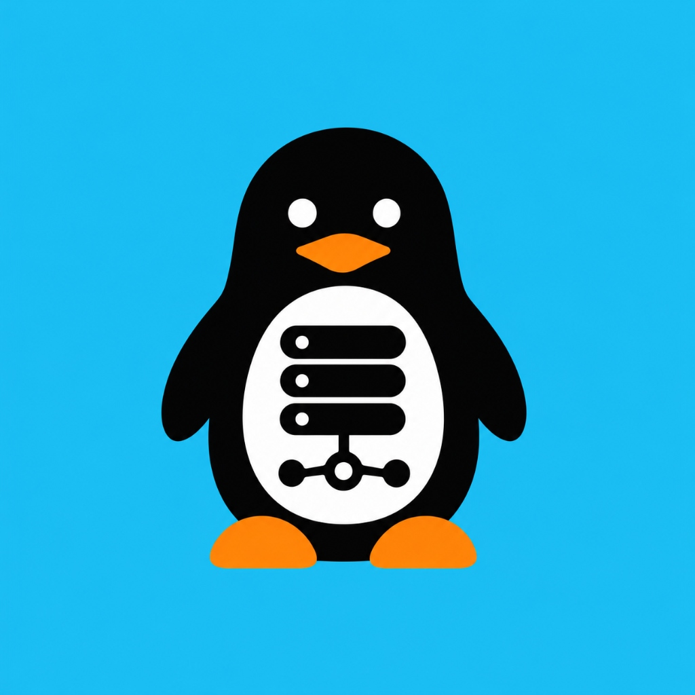

<p align="center">
  
</p>

# 🐧 Wave Server MCP

> **Serveur MCP (Model Context Protocol) pour Android permettant de connecter des modèles d'IA en interface (ChatGPT, Claude, Gemini, Cursor, Antigravity) à Wave Mobile Money via requêtes USSD directes.**

Contrôlez et automatisez vos opérations Wave (solde, transferts, SMS de confirmation, capture) en langage naturel directement depuis votre chat d'IA préféré, sans aucun câble USB ADB.

---

## 🎯 Contexte & Objectif

Les assistants IA comme **ChatGPT**, **Claude Desktop** ou **Gemini** ne disposent pas d'accès direct aux réseaux télécoms ni aux services de Mobile Money africains.

**Wave Server MCP** résout ce problème en transformant votre smartphone Android (via Termux) en un serveur MCP autonome. Il expose les commandes USSD officielles de Wave sous forme d'outils standardisés que n'importe quel LLM compatible MCP peut appeler en temps réel :

```
┌────────────────────────────────────────────────────────┐
│     Modèles d'IA / Interfaces Conversationnelles        │
│          (ChatGPT, Claude, Gemini, Antigravity)         │
└───────────────────────────┬────────────────────────────┘
                            │ Protocole MCP (JSON-RPC)
                            │ (Via pont STDIO ou HTTP)
┌───────────────────────────▼────────────────────────────┐
│         Serveur MCP Android (Termux en Wi-Fi)          │
│                serveur_mcp_telephone.py                │
└───────────────────────────┬────────────────────────────┘
                            │ Exécution native Android
                            │ (Termux:API / Telephony)
┌───────────────────────────▼────────────────────────────┐
│             Requêtes USSD Wave & Système               │
│        *9113# (Solde) | *9113*1*...# (Transferts)      │
└────────────────────────────────────────────────────────┘
```

---

## 🛠️ Outils MCP exposés aux modèles d'IA

| Nom de l'outil MCP | Description pour le LLM | Mécanisme USSD / Système |
|---|---|---|
| `consulter_solde_wave` | Consulte le solde Wave officiel en direct | Exécute la requête USSD `*9113#` ou extrait le dernier SMS de solde |
| `transferer_argent_wave` | Envoie de l'argent Wave vers un numéro destinataire | Exécute la commande USSD `*9113*1*NUMERO*MONTANT*PIN#` |
| `lire_sms_wave` | Récupère et filtre les SMS de transaction reçus de Wave | Lecture directe des SMS Android (`termux-sms-list`) |
| `lire_notifications_wave` | Intercepte les notifications push actives de l'app Wave | Écouteur de notifications Android |
| `capturer_ecran_telephone` | Capture l'écran du smartphone en direct (PNG Base64) | Capture native Android (`screencap`) |
| `analyser_ui_telephone` | Inspecte l'arborescence UI des éléments Wave à l'écran | Dump d'accessibilité UI (`uiautomator dump`) |
| `lancer_application` | Ouvre l'application Wave (`com.wave.personal`) | Lanceur Intent Android |
| `statut_telephone` | Remonte l'état de la batterie, du Wi-Fi et de l'appareil | Sondes matérielles Termux |
| `reveiller_telephone` | Réveille l'écran et garde l'appareil actif | Wake-lock et keyevent Android |

---

## ⚡ Exemples de requêtes utilisateur vers l'IA

Dès que le serveur MCP est connecté à votre IA :

- 💬 *"Quel est mon solde Wave actuel ?"*  
  ➔ L'IA appelle `consulter_solde_wave()` qui compose `*9113#` et vous répond : *"Votre solde Wave est de 45 200 FCFA."*

- 💬 *"Envoie 2 000 FCFA au 0701020304 pour le repas."*  
  ➔ L'IA appelle `transferer_argent_wave(numero_destinataire="0701020304", montant_fcfa=2000)` via la commande USSD sécurisée.

- 💬 *"Montre-moi les 3 derniers SMS de transactions Wave."*  
  ➔ L'IA appelle `lire_sms_wave(limite=3)` et affiche le détail des transferts récents.

---

## 🚀 Installation & Démarrage

### 1. Sur votre smartphone Android

1. Téléchargez et installez **[Termux](https://f-droid.org/fr/packages/com.termux/)** et **[Termux:API](https://f-droid.org/fr/packages/com.termux.api/)** depuis F-Droid.
2. Dans les paramètres Android de Termux:API, accordez les permissions : Téléphone (Appels USSD), SMS, Notifications.
3. Lancez dans Termux :

```bash
pkg update -y && pkg install -y git python termux-api
git clone https://github.com/issoufzousko-prog/wave-server-mcp.git
cd wave-server-mcp
chmod +x installer_mcp_termux.sh
./installer_mcp_termux.sh
```

Le serveur démarre sur le port `8765` et affiche son adresse IP (ex: `http://192.168.1.50:8765`).

---

## 🔌 Connexion aux interfaces IA (ChatGPT, Claude, Gemini)

### Claude Desktop (`claude_desktop_config.json`)

```json
{
  "mcpServers": {
    "wave-mcp": {
      "command": "python",
      "args": [
        "/chemin/vers/wave-server-mcp/pont_mcp_stdio_telephone.py"
      ],
      "env": {
        "IP_TELEPHONE": "192.168.1.50",
        "PORT_TELEPHONE": "8765",
        "WAVE_CODE_SECRET": "VOTRE_CODE_PIN"
      }
    }
  }
}
```

### Antigravity IDE / Cursor (`.agents/mcp_config.json`)

```json
{
  "mcpServers": {
    "wave-android": {
      "command": "python",
      "args": [
        "c:/chemin/vers/wave-server-mcp/pont_mcp_stdio_telephone.py"
      ],
      "env": {
        "IP_TELEPHONE": "192.168.1.50",
        "PORT_TELEPHONE": "8765",
        "WAVE_CODE_SECRET": "VOTRE_CODE_PIN"
      }
    }
  }
}
```

### ChatGPT / Gemini (via API ou Actions REST)

Le serveur expose également des endpoints HTTP directs pour les modèles ou connecteurs webhooks :
- `POST /mcp` : Endpoint standard JSON-RPC 2.0
- `GET /api/solde` : Solde Wave instantané
- `POST /api/transfert` : Transfert d'argent USSD
- `GET /api/sms` : Liste des derniers SMS de transactions

---

## 🔒 Sécurité & Confidentialité

- **Aucune dépendance externe requise** sur Android : s'exécute avec Python 3 natif.
- **Code PIN sanctuarisé** : Le code secret USSD est stocké localement dans vos variables d'environnement (`.env`) et n'apparaît jamais dans les logs.
- **Réseau 100% local** : Les requêtes transitent directement entre votre PC et votre téléphone via le Wi-Fi local sans passer par aucun serveur cloud.

---

## 📄 Licence

Distribué sous licence [MIT](LICENSE).

---

<p align="center">
  
</p>
